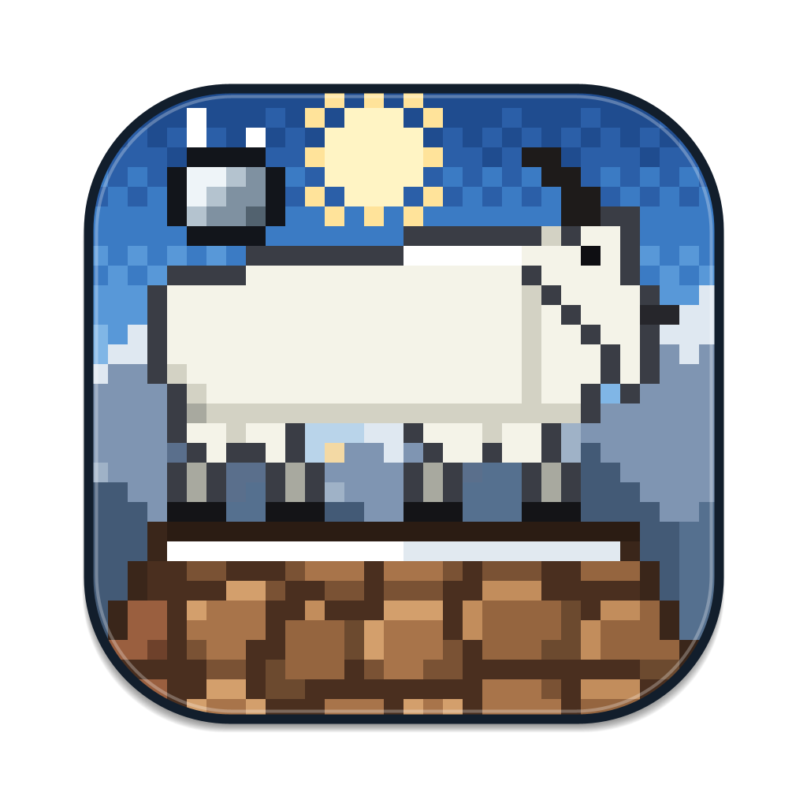

# Peakfall



A pixel-art Java Swing arcade game. Guide a sure-footed mountain goat up a
cliff and dodge everything the mountain throws down at you.

## Features

- **Hazards:** pebbles, rocks, huge boulders that bounce off the cliff edges,
  avalanches with one safe gap, and slippery ice patches. Rocks get faster and
  more frequent as you climb.
- **Warnings:** a flashing hazard sign at the top marks where each rock will
  drop. Avalanches flash red, with the safe gap in green.
- **Pickups:**

  | Pickup | Effect |
  | --- | --- |
  | Edelweiss | +250 points |
  | Helmet | Blocks one hit |
  | Hourglass | 5 seconds of slow motion |

- **Three hearts**, with a short invincibility flicker after each hit.
- **Dash** with Space for a burst of speed that rocks can't hit, on a cooldown.
- **Altitude zones:**

  | Altitude | Zone |
  | --- | --- |
  | 0 m | Pine Forest |
  | 150 m | Red Cliffs at sunset |
  | 350 m | Snowfields, with more ice |
  | 600 m | Starry Summit at night |

- **Goat skins** unlocked by best altitude: Classic, Red Scarf (100 m),
  Shadow (250 m) and Golden (500 m).
- **Saved progress:** best score, best altitude, run count, chosen skin and
  volume settings are kept between launches.
- **Juice:** retro sound effects generated in code (rumbles, hoof clatter, a
  goat bleat), screen shake, dust and snow particles, and a 3-2-1 countdown.
- **Screens:**
  - Home, with stats and a skin picker
  - How to Play
  - Settings, with music and sound volume and a progress reset
- **Fits any window:** opens full-window, the cliff stretches to fit, and wider
  cliffs get proportionally more rocks.

## Requirements

- Java JDK 14 or newer. Check with `java -version` and `javac -version`.
  If you don't have it, install a JDK such as [Eclipse Temurin](https://adoptium.net).

## Run

### VS Code (macOS or Windows)

Install the **Extension Pack for Java**, open the project folder, and run
`src/App.java` with the **Run** button.

### macOS (Terminal)

```sh
cd path/to/Peakfall
javac -d out src/*.java
java -Xdock:icon=src/assets/icon.png -Xdock:name=Peakfall -cp "out:src" App
```

The `-Xdock` options show the Peakfall icon and name in the Dock as soon as
the game starts. Without them, the game still runs, but the Java icon shows
for a moment before the Peakfall icon replaces it.

### Windows (Command Prompt or PowerShell)

```bat
cd path\to\Peakfall
javac -d out src\*.java
java -cp "out;src" App
```

The classpath separator is `:` on macOS and `;` on Windows. `src` is on the
classpath so the game can find its images, fonts and audio in `src/assets`.

You only need to run `javac` again after changing the code.

## Controls

| Key | Action |
| --- | --- |
| Arrow keys or W A S D | Move the goat |
| Space | Dash |
| Esc or P | Pause or resume |
| Enter | Play (home screen) or play again (game over) |
| A / D or arrow keys (home screen) | Change goat skin |
| Esc (Settings, How to Play) | Back to the home screen |
| Green window button or Ctrl+Cmd+F (macOS) | Toggle full screen |
| Maximize button (Windows) | Fill the screen |

## Project layout

| Path | Contents |
| --- | --- |
| `src/App.java` | Entry point |
| `src/GameFrame.java` | Window setup, full-window mode, app icon and screen switching |
| `src/MenuPanel.java` | Home screen: stats, skin picker and main buttons |
| `src/HelpPanel.java`, `src/SettingsPanel.java` | How to Play and Settings screens |
| `src/ScreenPanel.java` | Shared base for the menu screens |
| `src/PixelButton.java` | Pixel-art 3D buttons with icons |
| `src/GamePanel.java` | Gameplay loop, hazards, pickups, HUD, pause and game over |
| `src/Rock.java`, `src/Avalanche.java`, `src/IcePatch.java`, `src/Warning.java` | Hazards |
| `src/Pickup.java`, `src/Particle.java` | Pickups and visual effects |
| `src/Player.java`, `src/Skin.java` | The goat and its skins |
| `src/MountainArt.java` | Pixel-art renderer for scenery, altitude zones and the goat |
| `src/MusicManager.java`, `src/Sfx.java` | Music, and sound effects generated in code |
| `src/Save.java` | Saved scores, unlocks and settings (Java Preferences) |
| `src/Fonts.java` | Loads the Jersey 10 pixel font |
| `src/assets/` | Icon, fonts and audio |
